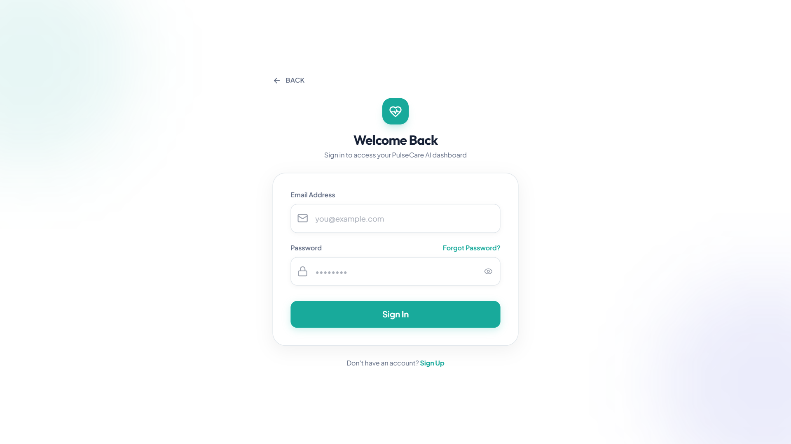
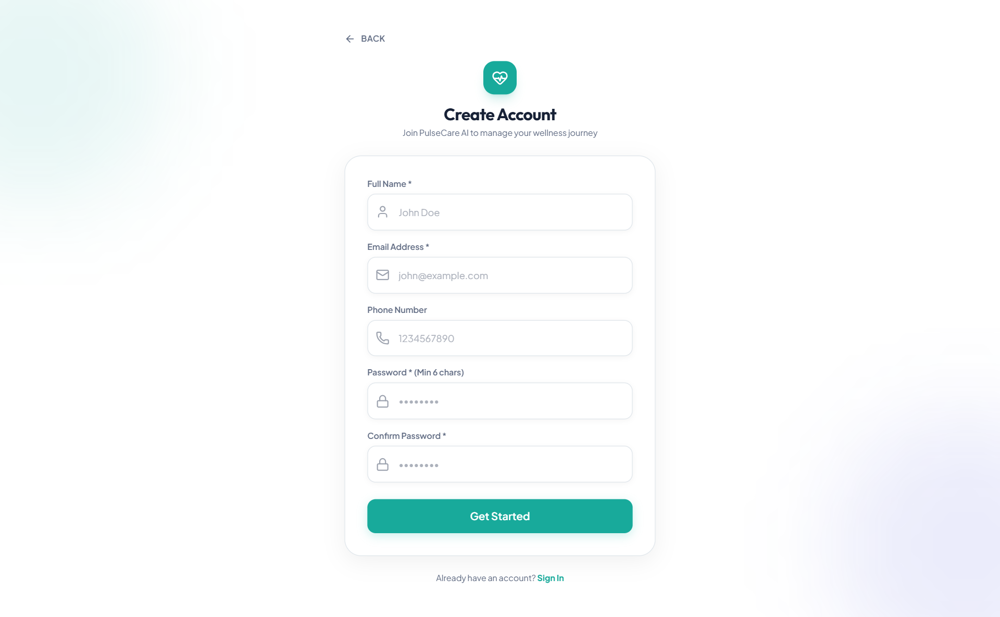
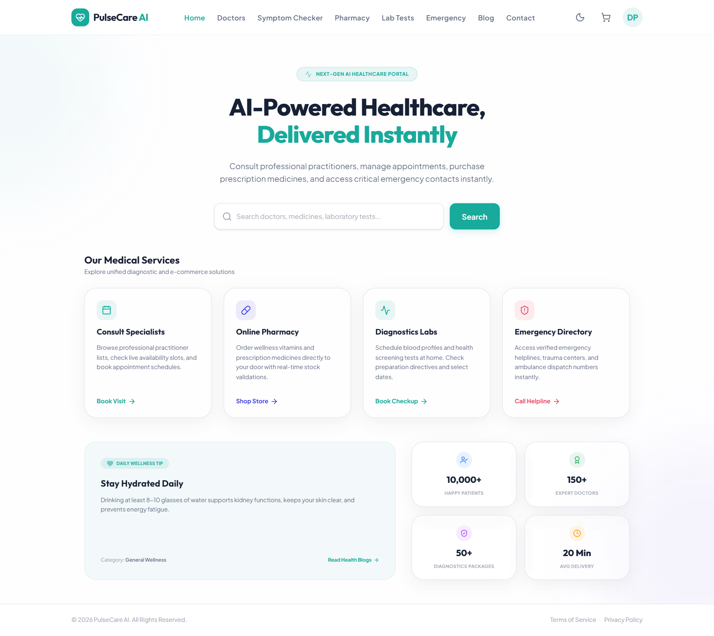
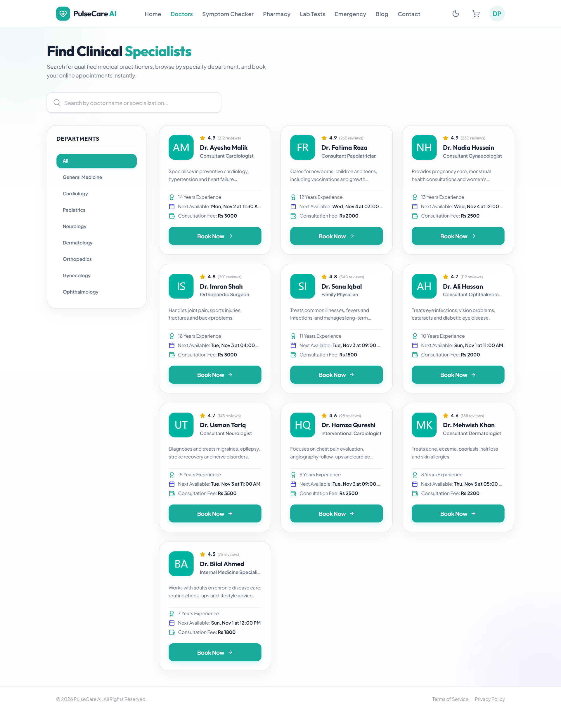
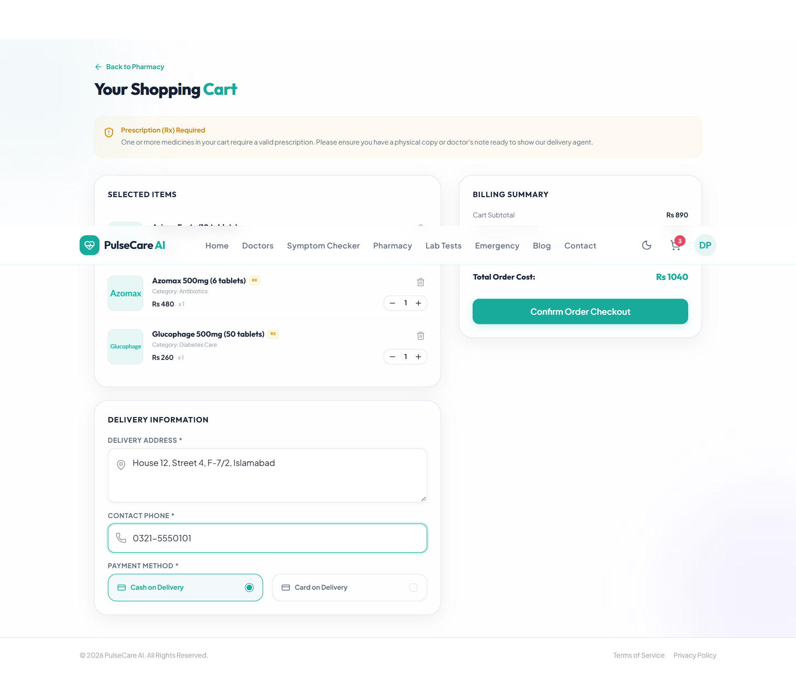
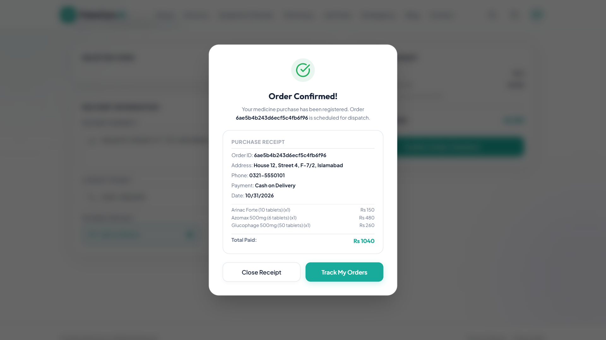
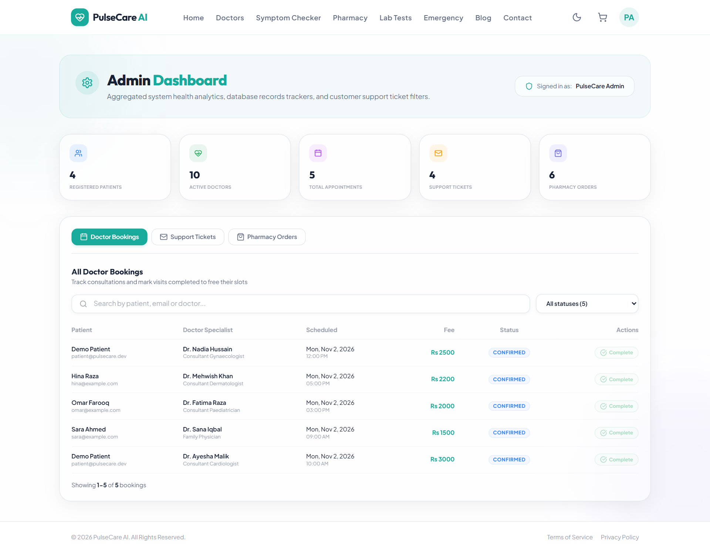

# PulseCare — AI-Powered Healthcare Portal

PulseCare is a responsive, secure, and modern healthcare management web application built to connect patients with medical services instantly. The platform integrates a medical directories directory, digital prescription shopping cart transactions, diagnostic lab scheduling, emergency phone dials, and blogs.

---

## 🚀 Key Features

*   **AI Symptom Checker (Gemini)**: Describe symptoms in plain language and get an urgency level (Emergency / Urgent / Routine / Self-Care), the matching clinical department, safe self-care tips, warning signs, and top-rated doctors from that department with one-click booking. Emergency keywords (chest pain, stroke signs, breathing difficulty, etc.) always escalate to the Emergency directory, even if the AI is unavailable.
*   **Specialist Consultations**: Browse certified medical practitioners, filter by departments (Cardiology, Pediatrics, Neurology, etc.), view live slots availability, and book digital appointments.
*   **Online Pharmacy Store**: Purchase prescription and over-the-counter wellness medications. Integrates real-time stock deductions and client-side prescription requirement alerts (Rx).
*   **At-Home Diagnostics Labs**: Schedule blood profile screenings and general checks. Access clear preparation guides, turnaround times (TAT), and fasting requirements.
*   **Emergency Contact Directory**: Instant access to local ambulance networks, critical blood banks, 24/7 trauma clinics, and emergency direct dial shortcuts.
*   **Health & Wellness Blog**: Explore medical advisories, dietary tips, and mental wellness guides written by certified clinical consultants.
*   **Billing & Shipping Checkout**: Manage items inside your shopping cart, input delivery info, select payment methods (Cash or Card on Delivery), and compile instant transactions receipt modals.
*   **Admin Sales Dashboard**: High-level telemetry displaying total clinic revenue, bookings count, pharmacy orders, active users count, and detailed transaction modals.

---

## 🎨 Premium UI Aesthetics & Animations

PulseCare features a custom visual system built using **Tailwind CSS v4** and **Framer Motion**:
*   **Brand Loader Overlay**: Intro splash animation showing the medical logo on a primary teal background.
*   **Eased Count-Up Counters**: Trust metrics count up from 0 using hardware-accelerated `requestAnimationFrame` with smooth deceleration.
*   **Staggered Card Reveals**: Lists, grids, and elements slide up sequentially in waves.
*   **Hover Lift & Photo Zoom**: Subtle cards hover offsets and image zooms on catalog products.
*   **Framer Motion Page Transitions**: Entering pages slide up and fade in smoothly using keyed locations.
*   **Grayscale Disabled Controls**: Active buttons turn neutral gray and block pointer clicks during submissions.
*   **Manual/System Dark Mode**: Automatic dark theme colors mapping.

---

## 🛠️ Technology Stack

*   **Frontend**: React 19 (Vite), Tailwind CSS v4, Framer Motion, Lucide React, React Router 7.
*   **Backend**: Node.js, Express, Mongoose, Google Gen AI SDK (Gemini), JSONWebTokens, Bcrypt.js, Node Mailer.
*   **Database**: MongoDB Atlas.

---

## 📦 Installation & Setup

### Prerequisites
*   Node.js (v18.0.0 or higher)
*   MongoDB Local Community Server or a MongoDB Atlas Cloud account

### 1. Database Configuration
1.  Navigate to the `backend/` directory.
2.  Create a `.env` file from the template and fill in your values. Each variable is explained in [`backend/.env.example`](./backend/.env.example):
    ```bash
    cp .env.example .env
    ```
    Only `MONGODB_URI` and `JWT_SECRET` are required; the server will not start without them.
3.  Get a free Gemini API key from [Google AI Studio](https://aistudio.google.com/apikey). Without it, the rest of the app works normally and the Symptom Checker returns a "not configured" message. The `/api/triage` endpoint is limited to 5 requests per minute per IP to stay within Gemini free-tier quotas.
4.  (Optional) To send real password reset emails through Gmail, fill in the `SMTP_*` and `FROM_EMAIL` values using a Gmail [App Password](https://myaccount.google.com/apppasswords). Without them, emails go to a test [Ethereal](https://ethereal.email) inbox and a preview link is printed in the backend terminal.
5.  (Optional) If the database connection times out with an error mentioning `querySrv` or `ETIMEOUT`, your network's DNS server may not resolve `mongodb+srv://` addresses. Set `DNS_SERVERS=1.1.1.1,8.8.8.8` in `.env` to use public DNS servers instead. Leave it empty to use your system DNS. You can check the connection on its own with `node db-check.js`.

### 2. Run the Backend Server
```bash
cd backend
npm install
npm run dev
```
*The server will start in development mode on `http://localhost:5000`.*

### 3. Load Sample Data (Seed Script)
A new database is empty, so the doctors, pharmacy, labs, emergency and blog pages have nothing to show. The seed script fills the database in `MONGODB_URI` with sample data:
```bash
cd backend
npm run seed
```
It adds:
*   10 doctors across all departments, each with weekly appointment slots
*   11 medicines (some need a prescription, and one has low stock so you can try the "insufficient stock" message at checkout)
*   10 lab tests, 6 emergency contacts and 5 blog articles
*   Two demo accounts:

    | Role    | Email                   | Password        |
    | ------- | ----------------------- | --------------- |
    | Admin   | `admin@pulsecare.dev`   | `Admin@12345`   |
    | Patient | `patient@pulsecare.dev` | `Patient@12345` |

It is safe to run more than once. Collections that already have data are skipped, and so are accounts that already exist. The data lives in [`backend/seed/seedData.js`](./backend/seed/seedData.js) if you want to change it. The doctors, clinics and articles are made up, and the images are placeholders.

To delete **everything** (users, appointments, orders, lab bookings, contact messages and the catalog) and start again from the sample data:
```bash
npm run seed -- --reset
```
Use this on a development database only. The script prints which database it connected to, and it refuses `--reset` when `NODE_ENV=production`. Change the demo passwords, or remove the accounts, before using the database anywhere public.

### 4. Run the API Tests
```bash
cd backend
npm test
```
The tests cover sign up, login, appointment booking and medicine orders. They use Node's built-in test runner with [Supertest](https://github.com/ladjs/supertest), and run against a temporary in-memory MongoDB from [mongodb-memory-server](https://github.com/typegoose/mongodb-memory-server). They never read `.env` or touch your real database. The first run downloads a MongoDB binary (about 100 MB), so it takes a while. Later runs use the cached copy.

On Windows, if every test fails with `Instance closed unexpectedly with code "3221225781"`, the MongoDB binary is missing system files. Install the latest [Microsoft Visual C++ Redistributable](https://learn.microsoft.com/en-us/cpp/windows/latest-supported-vc-redist?view=msvc-170) (x64) and run the tests again.

### 5. Run the Frontend Client
```bash
cd ../frontend
npm install
npm run dev
```
*The client app will launch on `http://localhost:5173/`.*

The frontend calls the backend at `http://localhost:5000` by default. To use a different address, copy [`frontend/.env.example`](./frontend/.env.example) to `frontend/.env` and set `VITE_API_URL`, then restart `npm run dev`.

---

## 📸 Screenshots & Previews

### 1. Intro Screen

*Full-screen medical teal branding loader.*

### 2. Login Screen

*Secure credentials input interface with disabled grayscale loading button states.*

### 3. Signup Screen

*Account registration portal with validation guidelines.*

### 4. Home Page

*AI-Powered Hero landing page with synced global search bar layout.*

### 5. Doctors Search Directory

*Specialist department listings with staggered entries and compact Book Now action triggers.*

### 6. Interactive Shopping Cart

*Cart item listings and billing summaries.*

### 7. Order Confirmation Modal

*Custom order transactions modal with purchase receipt summaries.*

### 8. Admin Telemetry Panel

*Tabbed management panel displaying order transactions list and revenue metrics.*

---

## 🔒 Security Measures
*   **Optional DNS Override**: If `DNS_SERVERS` is set in `backend/.env`, the server uses those DNS servers instead of your system DNS. This works around networks that can't resolve `mongodb+srv://` addresses. Without it, the system DNS is used.
*   **Auth Gates**: Admin panels and booking actions are guarded via server-side JWT verification middleware.
